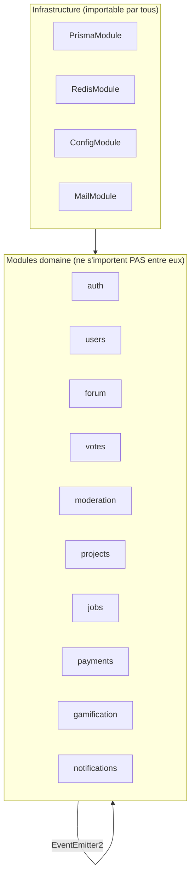
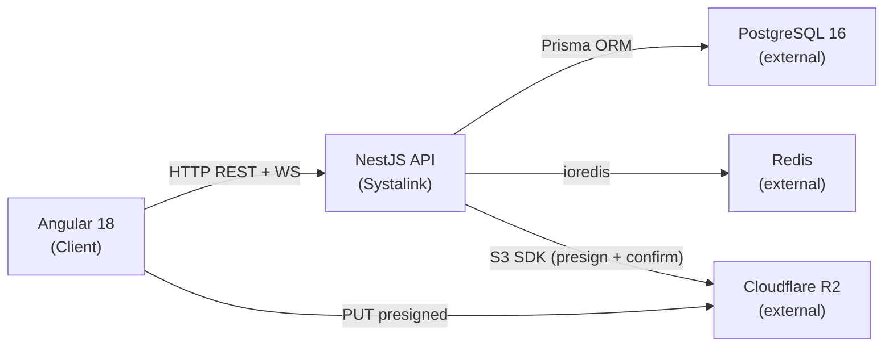

# Architecture Spine — AfriDev Hub Phase 1

## Design Paradigm

**Modular Monolith** — modules NestJS par domaine métier, déployés comme un unique processus Node.js sur Systalink. Les modules domaine communiquent via interfaces TypeScript injectées (synchrone) et EventEmitter2 in-process (side-effects). Zéro microservices Phase 1 ; la frontière module est la frontière d'équipe.



## Invariants & Rules

### AD-1 — Paradigme et communication inter-modules

- **Binds:** tous les modules domaine
- **Prevents:** couplage direct module-à-module via import NestJS ; adoption prématurée de CQRS ou d'un message broker externe
- **Rule:** appels synchrones cross-module → interface TypeScript injectée (`IForumService`, `IUsersService`, etc.) via token de provider partagé. Effets de bord → `EventEmitter2.emit('module.entity.action')`, `@OnEvent(...)` côté consumer. Un module domaine n'importe jamais directement un autre module domaine (voir AD-10). **Sélecteur de chemin** : EventEmitter2 est réservé aux side-effects fire-and-forget ; toute mutation cross-module nécessitant un résultat ou une propagation d'erreur passe exclusivement par l'interface synchrone.

### AD-2 — Propriété des données

- **Binds:** tous les modules domaine, tout accès Prisma
- **Prevents:** N+1 sur les lectures cross-module ; mutation non-contrôlée d'entités appartenant à un autre module
- **Rule:** lectures cross-module → joins Prisma sur champs publics uniquement. Mutations d'une entité → module owner exclusivement. Exemple : `ForumModule` lit `User.username` via join Prisma ; il ne mutate jamais la table `User`. **Cas explicite** : `GamificationModule` est le seul module autorisé à écrire le champ `User.reputation` ; tous les autres modules (forum, votes, users) le lisent uniquement en lecture via join Prisma.

### AD-3 — Autorisation [ADOPTED]

- **Binds:** FR-4 à FR-11, tous les endpoints protégés
- **Prevents:** logique d'autorisation dupliquée entre modules ; règles complexes d'ownership exprimées en décorateur
- **Rule:** `JwtAuthGuard` global (`app.module.ts`) ; routes publiques → `@Public()`. Règles de rôle simples (ADMIN, MODERATOR) → `@Roles()` + `RolesGuard` au niveau controller. Checks ownership et contexte métier → dans le service, jamais dans le controller.

### AD-4 — Abstraction PaymentProvider

- **Binds:** FR-35 à FR-40
- **Prevents:** routing provider dans le controller ; couplage controller/implémentation concrète
- **Rule:** `PaymentsController` reçoit uniquement `dto.provider`. `PaymentsService` résout via `PaymentProviderFactory` → `IPaymentProvider` (Wave | OrangeMoney | Stripe). Les trois providers sont actifs Phase 1. Ajout d'un provider = nouvelle class + enregistrement en factory, zéro changement controller ni service.

### AD-5 — Responsabilités des stores

- **Binds:** tous les modules avec persistance ou cache
- **Prevents:** révocation impossible des refresh tokens ; inconsistance des compteurs de rate limiting
- **Rule:** PostgreSQL → toutes entités métier, idempotency keys webhooks paiement, queue de modération. Redis → refresh tokens (whitelist JWT, TTL 7j), counters rate limiting, cache résultats full-text search.

### AD-6 — Upload de fichiers

- **Binds:** tout module attachant des fichiers (projets, avatars)
- **Prevents:** double transit bande passante côté serveur ; dégradation UX sur réseau 3G
- **Rule:** flow presigned URL : `POST /upload/presign` (NestJS émet URL signée R2 + contraintes MIME/taille) → `PUT` direct client→R2 → `POST /upload/confirm` (NestJS lie l'URL R2 à l'entité). NestJS ne proxie jamais les bytes de fichier.

### AD-7 — Enveloppe de réponse API [ADOPTED]

- **Binds:** tous les controllers
- **Prevents:** shapes hétérogènes par module ; parsing défensif côté Angular
- **Rule:** `ResponseInterceptor` global : succès → `{ data, meta? }`. `AllExceptionsFilter` global : erreur → `{ error: { code: string, message: string } }`. Codes d'erreur métier typés dans `libs/shared-types` (format : `DOMAINE_ENTITE_RAISON`).

### AD-8 — Notifications temps réel

- **Binds:** FR-18, tous les modules émettant des événements à notifier
- **Prevents:** couplage direct modules métier → Socket.io ; fan-out incontrôlé depuis plusieurs modules
- **Rule:** `NotificationsModule` est le seul consommateur Socket.io. Flow : `EventEmitter2.emit(...)` → `@OnEvent(...)` dans `NotificationsService` → save DB + push socket. `NotificationsGateway` maintient `Map<userId, Socket>` (Phase 1, mono-instance). Redis adapter → Phase 2, sans changement d'interface gateway.

### AD-9 — Déploiement Phase 1

- **Binds:** toute la stack backend
- **Prevents:** dépendance à des primitives cloud incompatibles avec Systalink (Lambda, Cloud Run, K8s auto-scaling)
- **Rule:** cible Systalink. Backend NestJS déployé comme processus Node.js unique. Dépendances externes (PostgreSQL, Redis, Cloudflare R2) provisionnées séparément. R2 accédé via `@aws-sdk/client-s3` (API S3-compatible). **Conflit PRD** : le PRD référence VPS OVH (NFR-8, FR-2) ; cette spine est la référence authoritative — Systalink est la cible canonique Phase 1. Le PRD doit être mis à jour en conséquence.

### AD-10 — Graphe de dépendances NestJS

- **Binds:** tous les modules domaine
- **Prevents:** dépendances circulaires NestJS → crash au démarrage
- **Rule:** aucun module domaine n'importe un autre module domaine. Seuls PrismaModule, RedisModule, ConfigModule et MailModule (couche infrastructure) peuvent être importés par tous. Communication cross-module → interfaces injectées (AD-1) et EventEmitter2 (AD-1) uniquement.

### AD-11 — Configuration

- **Binds:** tous les modules
- **Prevents:** variable d'environnement manquante détectée à l'exécution en prod sur Systalink
- **Rule:** toute variable d'env → `ConfigService` injecté (`@nestjs/config`) uniquement. `AppModule` déclare un schéma Joi validant toutes les vars au démarrage — var manquante = refus de démarrer avec message explicite. Aucun `process.env.X` direct dans un module domaine.

### AD-12 — Logging

- **Binds:** tous les modules
- **Prevents:** logs non-structurés inexploitables sur Systalink ; hétérogénéité de format entre modules
- **Rule:** `nestjs-pino` (`LoggerModule.forRoot()`) remplace le logger natif NestJS. JSON structuré en prod, pretty-print (`pino-pretty`) en dev. Aucun `console.log` dans le code applicatif — logger injecté uniquement.

## Consistency Conventions

| Concern | Convention |
| --- | --- |
| Interfaces de service | `I{Module}Service` — ex. `IForumService`, `IPaymentsService` |
| Événements EventEmitter2 | `<module>.<entity>.<action>` — ex. `forum.question.created`, `payments.session.completed` |
| Identifiants | UUID v4 (`@default(uuid())` Prisma) |
| Dates | ISO 8601 UTC en base ; `Intl.DateTimeFormat` côté frontend |
| Montants monétaires | Entiers en centimes/unités minimales (FCFA, NGN, USD cents) — jamais float |
| Codes d'erreur métier | `DOMAINE_ENTITE_RAISON` SCREAMING_SNAKE — ex. `FORUM_QUESTION_NOT_FOUND`, `PAYMENTS_WEBHOOK_DUPLICATE` |
| Routes publiques | `@Public()` sur tout endpoint sans authentification JWT |
| Variables d'env | Déclarées dans le schéma Joi de `AppModule` ; injectées via `ConfigService` |
| Payloads événements EventEmitter2 | Interfaces TypeScript typées déclarées dans `libs/shared-types` — jamais `any` ni objet littéral non typé |
| Checks conditionnels données (ex. réputation ≥ 10) | Dans le service uniquement — jamais exprimés en Guard ou décorateur |
| Contrat de données (schéma ↔ DTO ↔ types partagés) | Schéma Prisma = source des champs et enums ; voir `data-contract-afridev-hub-phase1.md` |

## Stack

| Name | Version |
| --- | --- |
| Node.js | ≥ 20 LTS |
| NestJS | 10.4.x |
| TypeScript | 5.5.x |
| Prisma | 5.20.x |
| PostgreSQL | 16 (external) |
| ioredis | 5.4.x |
| Socket.io | 4.8.x |
| @nestjs/event-emitter (EventEmitter2) | ^2.0 |
| nestjs-pino + pino-pretty | ^4.x |
| @nestjs/config | 3.3.x |
| Joi | ^17 |
| Passport.js | 0.7.x |
| @nestjs/jwt | 10.2.x |
| @aws-sdk/client-s3 | ^3.x |
| @nestjs/schedule | ^4.x |
| Cloudflare R2 | external (S3-compatible) |
| Systalink | Phase 1 platform |

## Structural Seed



```text
apps/api/src/
  app.module.ts               # bootstrap : ConfigModule(Joi), guards globaux, interceptors, filters
  common/
    interceptors/             # ResponseInterceptor (AD-7)
    filters/                  # AllExceptionsFilter (AD-7)
    guards/                   # JwtAuthGuard (global), RolesGuard (AD-3)
    decorators/               # @Public(), @Roles() (AD-3)
  auth/                       # inscription, OAuth, JWT — implémente IAuthService
  users/                      # profils, réputation, badge vérifié — implémente IUsersService
  forum/                      # questions, réponses, doublons, recherche — implémente IForumService
  votes/                      # votes questions/réponses — implémente IVotesService
  moderation/                 # queue signalements — implémente IModerationService
  projects/                   # vitrine, import GitHub — implémente IProjectsService
  jobs/                       # offres, candidatures, alertes — implémente IJobsService
  payments/                   # PaymentProviderFactory, Wave/OM/Stripe — implémente IPaymentsService
  gamification/               # score réputation — implémente IGamificationService
  notifications/              # NotificationsGateway (Socket.io), NotificationsService (AD-8)
  prisma/                     # PrismaModule — infrastructure
  redis/                      # RedisModule — infrastructure
  mail/                       # MailModule — infrastructure (email transactionnel)
```

## Capability → Architecture Map

| Capability | Lives in | Governed by |
| --- | --- | --- |
| FR-4–FR-10 (Auth, OAuth, profil, badge) | auth/, users/ | AD-3, AD-10, AD-11 |
| FR-11 (Score de réputation) | gamification/ | AD-1 (events forum/votes→gamification), AD-2 |
| FR-12–FR-17 (Forum Q&A, votes, réponse acceptée) | forum/, votes/ | AD-1, AD-2, AD-7, AD-10 |
| FR-18 (Notifications) | notifications/ | AD-8 |
| FR-19 (Recherche full-text) | forum/ + Redis cache | AD-5, AD-7 |
| FR-20–FR-21 (Signalement, modération) | moderation/ | AD-1, AD-3, AD-7 |
| FR-22–FR-27 (Vitrine projets, import GitHub) | projects/ | AD-2, AD-6, AD-7, AD-10 |
| FR-28–FR-34 (Job Board, candidatures, alertes) | jobs/ | AD-2, AD-7, AD-10 |
| FR-35–FR-40 (Paiements, webhooks, reçu email) | payments/ | AD-4, AD-5, AD-7 |
| Upload fichiers (avatars, assets projets) | tout module → endpoint /upload | AD-6 |

## Deferred

- **Redis adapter Socket.io** — multi-instance Phase 2 ; gateway conçue sans changement d'interface (AD-8)
- **CQRS / message broker externe** — Phase 2 si la charge l'impose ; EventEmitter2 est le plancher
- **Full-text engine externe** (Elasticsearch, Algolia) — Phase 1 : PostgreSQL full-text + cache Redis (AD-5)
- **Queue de jobs background (BullMQ)** — Phase 1 : `@nestjs/schedule` (cron intégré NestJS) pour email alerts (FR-32), expiration offres (FR-33), reçus (FR-40) ; BullMQ déféré Phase 2 (pas un invariant spine)
- **Seuils rate limiting** — valeurs déléguées à l'implémentation ; Redis est le store (AD-5)
- **Scaling horizontal NestJS** — incompatible avec in-memory Socket.io map Phase 1 ; Phase 2 avec Redis adapter
- **Modules Phase 2** : mentorat (FR-41–FR-49), groupes communautaires, PWA offline (FR-50+)
- **FR-1 (setup Nx monorepo) et FR-2 (CI/CD GitHub Actions)** — conventions de build et pipeline ; ne constituent pas des invariants architecturaux NestJS backend ; implémentation déléguée
- **Service de taux de change** (FR-29, FR-30) — `CurrencyService` pour conversion FCFA/NGN/USD ; implémentation déléguée (API externe ou table statique) ; pas un invariant spine
- **Enveloppe opérationnelle Phase 1** — gestionnaire de processus (PM2), monitoring/error-tracking (ex. Sentry), terminaison HTTPS/SSL, stratégie de promotion staging→prod — à définir à l'implémentation
